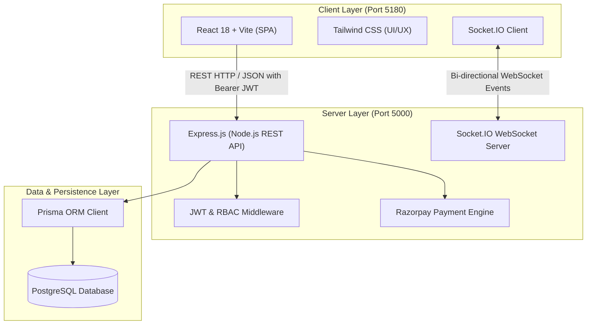

# 📘 FIELDFIX — Complete Project Documentation & Evaluation Dossier
**Academic & Industry Software Engineering Evaluation Document**  
**Project Title:** FieldFix – On-Demand Field Service & Home Maintenance Dispatch Platform  
**Roll Numbers:** 2024300098 & 2024300101  
**Repository:** `FieldFix`  

---

## 📑 TABLE OF CONTENTS
1. [Executive Summary & Abstract](#1-executive-summary--abstract)
2. [Problem Statement & Motivation (The "WHY")](#2-problem-statement--motivation-the-why)
3. [System Architecture & Tech Stack (The "WHAT" &  Rationale)](#3-system-architecture--tech-stack-the-what--rationale)
4. [Codebase Organization & File Map (The "WHERE")](#4-codebase-organization--file-map-the-where)
5. [Core Modules & Implementation Details (The "HOW")](#5-core-modules--implementation-details-the-how)
6. [Database Schema & Data Relationships](#6-database-schema--data-relationships)
7. [API Specification (REST Endpoints)](#7-api-specification-rest-endpoints)
8. [Software Engineering Best Practices Applied](#8-software-engineering-best-practices-applied)
9. [Viva & Project Evaluation Q&A (Examiner Cheat Sheet)](#9-viva--project-evaluation-qa-examiner-cheat-sheet)

---

## 1. Executive Summary & Abstract

**FieldFix** is a full-stack, enterprise-grade on-demand field service dispatch platform designed to bridge the gap between residential consumers, verified service technicians (plumbers, electricians, appliance mechanics, cleaners), and operational administrators. 

The system implements:
- **Multi-Role Portal Access:** Granular interfaces and permissions for **Customers**, **Technicians**, and **Administrators**.
- **Service Discovery & Scheduling:** Searchable directory by skill specialization, location (city), and live availability.
- **Dynamic State Machine:** Strictly enforced state transitions for service lifecycles (`AWAITING_PAYMENT` → `PENDING` → `ACCEPTED` → `IN_PROGRESS` → `COMPLETED`).
- **Cryptographic Payment Gateway Integration:** Server-priced order creation and HMAC-SHA256 signature verification powered by Razorpay.
- **Bi-Directional Real-Time Engine:** Live GPS coordinates streaming via WebSockets (Socket.IO).
- **Communication & Quality Assurance:** In-app ticketing/messaging and authenticated 1-to-5 star rating & review pipelines.

---

## 2. Problem Statement & Motivation (The "WHY")

### The Real-World Problem:
1. **Unorganized Service Market:** Traditional home maintenance relies on unvetted freelancers with unpredictable pricing, uncertain turnaround times, and lack of accountability.
2. **No Real-Time Visibility:** Customers are unable to see when a technician is actually en-route, leading to missed appointments and frustration.
3. **Payment Security Risks:** Cash transactions lack audit trails, dispute resolution, and guaranteed service guarantees.
4. **Technician Inefficiency:** Technicians lose hours manually finding clients, negotiating rates, and planning travel routes.

### The FieldFix Solution:
FieldFix centralizes this ecosystem with:
- Standardized base pricing per category to eliminate predatory charges.
- Mandatory background/trade board ID verification (`technicianVerifiedId`).
- Real-time GPS broadcasting for live travel tracking.
- Pre-authorized escrow-like digital payment workflows with zero tamper risk.
- Central administrative audit oversight over disputes, volume metrics, and active personnel.

---

## 3. System Architecture & Tech Stack (The "WHAT" & Rationale)



### Technology Selection & Justification:

| Layer | Technology | Why Chosen? (Design Decision) |
|---|---|---|
| **Frontend UI** | **React 18 + Vite + TypeScript** | Blazing-fast development server (HMR), component reusability, and strong compile-time type safety preventing runtime UI bugs. |
| **Styling** | **Tailwind CSS 3 + Lucide Icons** | Utility-first CSS providing modern, responsive, mobile-first design without heavy runtime style overhead. |
| **Backend API** | **Node.js + Express 4 (TypeScript)** | Asynchronous, non-blocking I/O ideal for high concurrency; shared TypeScript interfaces between backend and frontend models. |
| **Real-Time Gateway** | **Socket.IO** | Automatic fallback between WebSockets and long-polling; low-latency bidirectional streaming of live technician GPS coordinates. |
| **Database** | **PostgreSQL** | Strict ACID compliance, relational integrity, foreign key cascades, and high performance for concurrent transactional queries. |
| **ORM** | **Prisma 5** | Type-safe database queries, auto-generated TypeScript definitions, automated schema migrations, and visual data inspection via **Prisma Studio**. |
| **Authentication** | **JWT (`jsonwebtoken`) + `bcrypt`** | Stateless authentication eliminating server memory sessions; 10-salt-round cryptographic hashing of credentials. |
| **Payment Gateway** | **Razorpay Node SDK & Checkout** | End-to-end payment security with server-side HMAC-SHA256 signature verification preventing client-side price tampering. |

---

## 4. Codebase Organization & File Map (The "WHERE")

```text
FieldFix/
├── admin-dashboard/                       # Front-end Web Application (Vite + React)
│   ├── src/
│   │   ├── pages/                         # Core Portal Screens
│   │   │   ├── LoginPage.tsx              # Role-aware authentication screen
│   │   │   ├── RegisterPage.tsx           # Customer & Technician registration
│   │   │   ├── CustomerPortalPage.tsx     # Technician catalog, booking & payment modal
│   │   │   ├── TechnicianPortalPage.tsx   # Job queue, status updater, GPS toggler
│   │   │   ├── AdminDashboardPage.tsx     # Live analytics & operational metrics
│   │   │   └── SupportInboxPage.tsx       # Real-time customer/tech support threads
│   │   ├── services/
│   │   │   ├── api.ts                     # Central Axios instance + JWT interceptor
│   │   │   ├── auth.ts                    # Auth state, login/logout, role decoders
│   │   │   └── socket.ts                  # Socket.io client for real-time GPS pings
│   │   ├── components/                    # Reusable UI cards, modal dialogs, status badges
│   │   ├── App.tsx                        # Client-side routing (React Router)
│   │   └── main.tsx                       # React DOM entry point
│   └── package.json
│
├── backend/                               # Back-end API & WebSocket Server
│   ├── prisma/
│   │   ├── schema.prisma                  # PostgreSQL entity models & relations
│   │   └── seed.ts                        # Master seeding script (categories, tech profiles, users)
│   ├── src/
│   │   ├── middleware/
│   │   │   └── auth.ts                    # Bearer token verification & Role Guard
│   │   ├── routes/
│   │   │   ├── auth.ts                    # Register, login, technician directory, availability
│   │   │   ├── bookings.ts                # Booking lifecycle, status transitions
│   │   │   ├── payments.ts                # Razorpay order generation & signature verify
│   │   │   ├── messages.ts                # Threaded support messaging endpoints
│   │   │   └── stats.ts                   # Admin aggregated counter metrics
│   │   ├── app.ts                         # Express middleware & router registration
│   │   └── server.ts                      # HTTP + Socket.IO server initialization
│   ├── .env                               # Database connection URL, JWT secret, Razorpay keys
│   └── package.json
│
├── docs/                                  # Project Documentation
│   ├── PROJECT_EVALUATION_REPORT.md       # Master comprehensive evaluation report
│   ├── ER_DIAGRAM.md                      # Complete Entity-Relationship visual & constraints
│   ├── STATE_TRANSITION.md                # Booking lifecycle state diagram
│   └── README.md                          # Architecture and run instructions
└── package.json                           # Root npm workspaces script runner
```

---

## 5. Core Modules & Implementation Details (The "HOW")

### Module 1: User Authentication & Role-Based Access Control (RBAC)
- **Files:** `backend/src/routes/auth.ts`, `backend/src/middleware/auth.ts`, `admin-dashboard/src/services/auth.ts`
- **Implementation:**
  - Users authenticate with Email & Password. Passwords are encrypted using **Bcrypt (10 salt rounds)** before database storage.
  - Upon valid credentials, the server signs a **JSON Web Token (JWT)** embedding `{ userId, email, role }` with a 7-day expiration.
  - The middleware `requireRole(['ADMIN'])` or `requireRole(['TECHNICIAN'])` enforces access control at the route level.
  - The frontend Axios interceptor automatically attaches `Authorization: Bearer <token>` to all HTTP requests.

### Module 2: Technician Discovery & Profile Verification
- **Files:** `backend/src/routes/auth.ts` (`GET /api/auth/technicians`), `admin-dashboard/src/pages/CustomerPortalPage.tsx`
- **Implementation:**
  - Technicians register with a mandatory government/trade board ID (`technicianVerifiedId`), skills list, experience years, and base city.
  - Customers can search technicians via multi-parameter filtering: by **Name**, **Skill category** (e.g., Plumbing, Electrical, Cleaning), and **City**.
  - Technicians have an active `isAvailable` Boolean switch (`PATCH /api/auth/technicians/availability`). If toggled off, they cannot receive new job dispatch offers.

### Module 3: Booking Lifecycle & State Transitions
- **Files:** `backend/src/routes/bookings.ts`, `docs/STATE_TRANSITION.md`
- **Implementation:**
  - State Machine progression:
    $$\text{AWAITING\_PAYMENT} \longrightarrow \text{PENDING} \longrightarrow \text{ACCEPTED} \longrightarrow \text{IN\_PROGRESS} \longrightarrow \text{COMPLETED}$$
  - A booking is created in `AWAITING_PAYMENT`. It only transitions to `PENDING` once the backend cryptographically verifies the payment.
  - Only the assigned technician can update status from `PENDING` $\to$ `ACCEPTED` $\to$ `IN_PROGRESS` $\to$ `COMPLETED`.
  - Customers or admins can trigger `CANCELLED` before the technician begins work, which initiates automated refund protocols.

### Module 4: Secure Payment Gateway (Razorpay)
- **Files:** `backend/src/routes/payments.ts`, `admin-dashboard/src/pages/CustomerPortalPage.tsx`
- **Implementation:**
  - **No Client Price Tampering:** The frontend never sends the booking price to the gateway. Instead, it sends the `categoryId` to the backend. The backend queries the database for `category.basePrice`, creates an official Razorpay Order, and returns the generated `order_id`.
  - **Signature Verification:** When payment completes, Razorpay returns `razorpay_order_id`, `razorpay_payment_id`, and `razorpay_signature`.
  - The server computes an HMAC-SHA256 hash using the secret key:
    $$\text{Generated Signature} = \text{HMAC-SHA256}(\text{order\_id} + "|" + \text{payment\_id}, \text{RAZORPAY\_KEY\_SECRET})$$
  - If the generated signature equals the received signature, the payment record is saved as `PAID` and the booking is activated.

### Module 5: Real-Time Technician Tracking & Location Dispatch
- **Files:** `backend/src/server.ts`, `admin-dashboard/src/services/socket.ts`
- **Implementation:**
  - Uses **Socket.IO** running on port 5000 alongside Express.
  - While a job is `ACCEPTED` or `IN_PROGRESS`, the technician's browser invokes HTML5 Geolocation (`navigator.geolocation.watchPosition`).
  - The client emits `technician:location:update` containing `{ technicianId, lat, lng }`.
  - The server updates the database coordinates and broadcasts `booking:location:<id>` to the customer's portal in real time without refreshing the page.

### Module 6: In-App Support & Chat System
- **Files:** `backend/src/routes/messages.ts`, `admin-dashboard/src/pages/SupportInboxPage.tsx`
- **Implementation:**
  - Supports both direct job-related customer-technician chats and dedicated Help & Support tickets.
  - Chat messages are indexed by `threadId` and chronological timestamp (`createdAt`) to allow fast retrieval of historical conversations.
  - Administrators have a global inbox overview to monitor all interactions and resolve escalations.

### Module 7: Review & Rating System
- **Files:** `backend/prisma/schema.prisma` (`Review` model)
- **Implementation:**
  - After a booking reaches `COMPLETED`, the customer can submit a 1 to 5 star rating with text feedback.
  - Reviews have a strict 1-to-1 relationship with the `Booking` ID to eliminate fake or duplicate reviews.
  - The technician profile stores an aggregate calculated `rating` field and `totalJobs` count.

### Module 8: Admin Operational Analytics
- **Files:** `backend/src/routes/stats.ts`, `admin-dashboard/src/pages/AdminDashboardPage.tsx`
- **Implementation:**
  - Administrative dashboard displays aggregated platform metrics: Total Bookings, Active Technicians, Pending Jobs, and Total Revenue collected.
  - Role-guarded so regular customers or technicians cannot access statistical financial data.

---

## 6. Database Schema & Data Relationships

### Entity Relationship Summary

```
[User] (1) ────── (1) [TechnicianProfile]
   │
   ├── (1) ────── (N) [Booking] (Customer)
   ├── (1) ────── (N) [Booking] (Assigned Technician)
   ├── (1) ────── (N) [Review]  (Reviewer)
   ├── (1) ────── (N) [Review]  (Target)
   └── (1) ────── (N) [ChatMessage] (Sender)

[ServiceCategory] (1) ── (N) [Booking]
[Booking]         (1) ── (1) [Payment]
[Booking]         (1) ── (1) [Review]
```

### Table Definitions:

1. **`users`**:
   - `id` (UUID, Primary Key)
   - `email` (String, Unique)
   - `passwordHash` (String, Bcrypt hash)
   - `name` (String), `phone` (String)
   - `role` (`CUSTOMER` | `TECHNICIAN` | `ADMIN`)
   - `createdAt`, `updatedAt` (DateTime)

2. **`technician_profiles`**:
   - `id` (UUID, PK), `userId` (UUID, FK referencing `users.id` with `onDelete: Cascade`)
   - `technicianVerifiedId` (String, Unique – e.g. `TECH-KA-2023-0104`)
   - `skills` (JSON Array), `specialization` (String), `bio` (String), `city` (String)
   - `experienceYears` (Int), `isAvailable` (Boolean, default `true`)
   - `currentLat` (Float), `currentLng` (Float)
   - `rating` (Float, default `0.0`), `totalJobs` (Int, default `0`)

3. **`service_categories`**:
   - `id` (UUID, PK), `name` (String, Unique – e.g., "Plumbing", "Electrical", "HVAC")
   - `description` (String), `basePrice` (Float, in INR), `icon` (String)

4. **`bookings`**:
   - `id` (UUID, PK)
   - `customerId` (UUID, FK $\to$ `users.id`)
   - `technicianId` (UUID, FK $\to$ `users.id`, Nullable)
   - `categoryId` (UUID, FK $\to$ `service_categories.id`)
   - `status` (`AWAITING_PAYMENT` | `PENDING` | `ACCEPTED` | `IN_PROGRESS` | `COMPLETED` | `CANCELLED`)
   - `address` (String), `latitude` (Float), `longitude` (Float)
   - `scheduledAt` (DateTime), `totalAmount` (Float), `description` (String)

5. **`payments`**:
   - `id` (UUID, PK), `bookingId` (UUID, FK $\to$ `bookings.id`, Unique)
   - `amount` (Float), `provider` (String, "Razorpay")
   - `transactionId` (String, Unique), `status` (`PENDING` | `PAID` | `FAILED`)

6. **`reviews`**:
   - `id` (UUID, PK), `bookingId` (UUID, FK $\to$ `bookings.id`, Unique)
   - `reviewerId` (UUID, FK $\to$ `users.id`), `targetId` (UUID, FK $\to$ `users.id`)
   - `rating` (Int, 1 to 5), `comment` (String)

7. **`chat_messages`**:
   - `id` (UUID, PK), `threadId` (String, indexed), `senderId` (UUID, FK $\to$ `users.id`)
   - `body` (String), `createdAt` (DateTime)

---

## 7. API Specification (REST Endpoints)

All endpoints run on `http://localhost:5000/api` and require `Authorization: Bearer <JWT>` for authenticated operations.

| HTTP Method | Route | Access Level | Description |
|---|---|---|---|
| `GET` | `/health` | Public | Server health and uptime verification |
| `POST` | `/auth/register` | Public | Registers a new Customer or Technician |
| `POST` | `/auth/login` | Public | Validates credentials and returns JWT token & user object |
| `GET` | `/auth/technicians` | Public / Auth | Lists technicians filtered by `name`, `skill`, `city`, `available` |
| `PATCH` | `/auth/technicians/availability` | Technician / Admin | Toggles technician online/offline availability |
| `GET` | `/bookings` | Authenticated | Lists bookings scoped to the requesting role (Admin sees all) |
| `PATCH` | `/bookings/:id/status` | Assigned Tech / Admin | Transitions booking status (`ACCEPTED`, `IN_PROGRESS`, `COMPLETED`) |
| `POST` | `/payments/order` | Customer | Creates booking record and generates Razorpay Order ID |
| `POST` | `/payments/verify` | Customer | Verifies Razorpay HMAC signature and confirms booking |
| `POST` | `/payments/fail` | Customer | Cancels unpaid booking if checkout is aborted |
| `GET` | `/messages?threadId=...` | Authenticated | Fetches chat thread conversation history |
| `POST` | `/messages` | Authenticated | Sends a new message in a booking or support thread |
| `GET` | `/messages/threads` | Admin | Fetches list of all active support conversations |
| `GET` | `/stats` | Admin | Returns system counts (bookings, technicians, revenue) |

---

## 8. Software Engineering Best Practices Applied

1. **Separation of Concerns (SoC) / 3-Tier Architecture:**
   - Presentation Layer (React SPA), Business Logic Layer (Express Routes & Services), and Data Persistence Layer (Prisma ORM & PostgreSQL) are completely decoupled.
2. **Defensive API Design:**
   - Strict input validation on all routes.
   - Comprehensive error handling blocks with descriptive HTTP status codes (`400 Bad Request`, `401 Unauthorized`, `403 Forbidden`, `404 Not Found`, `500 Server Error`).
3. **Security Standards:**
   - No plaintext passwords stored (`bcrypt` with 10 salt rounds).
   - Tamper-proof payment verification using cryptographic HMAC-SHA256 hashes.
   - Secrets (`JWT_SECRET`, `DATABASE_URL`, `RAZORPAY_KEY_SECRET`) isolated in `.env` files and never committed to version control.
4. **Data Consistency & Database Seeding:**
   - Automated seeding via `backend/prisma/seed.ts` providing standard categories, technicians across multiple cities, and test accounts.
   - Cascading deletions configured on relations to prevent orphan records.
5. **Git Workflow & Version Control:**
   - Feature branching strategy (`shrutika/admin-login-page`) ensuring clean commits and traceability across team members.

---

## 9. Viva & Project Evaluation Q&A (Examiner Cheat Sheet)

#### Q1: Why did you use Prisma ORM instead of writing raw SQL queries?
> **Answer:** Prisma provides compile-time type safety. When our schema changes, Prisma automatically generates updated TypeScript definitions. This eliminates SQL injection vulnerabilities, prevents syntax typos in complex joins, and speeds up development while still running optimized queries against PostgreSQL.

#### Q2: How does your system prevent a customer from faking a successful payment?
> **Answer:** The frontend never directly approves a payment. The customer only gets a signed payload from the payment gateway. That payload is sent to our backend `POST /api/payments/verify`, which recalculates the HMAC-SHA256 hash using our secret server key. If the hash does not match identically, the payment is rejected and the booking is marked failed.

#### Q3: How is real-time location tracking implemented without overloading the server?
> **Answer:** We use **Socket.IO** over WebSockets instead of HTTP polling. The technician’s browser listens to HTML5 geolocation changes and pushes small JSON coordinates over an active, persistent connection. The server then pushes this update directly to the subscribed customer’s socket room with sub-second latency.

#### Q4: What is the difference between a Customer, Technician, and Admin account in your database?
> **Answer:** All users exist in the `User` table for unified authentication. Their permissions are governed by the `role` attribute (`CUSTOMER`, `TECHNICIAN`, `ADMIN`). If a user has the `TECHNICIAN` role, they additionally have a 1-to-1 relationship with a `TechnicianProfile` record storing their verified trade ID, skills array, availability toggle, and geographic coordinates.

#### Q5: What happens if a customer books a technician who is currently offline?
> **Answer:** Technicians maintain an `isAvailable` status. The frontend discovery query filters technicians with `isAvailable: true`. If a technician marks themselves unavailable, they do not appear in active search results, preventing customer drop-offs and unfulfilled service requests.
